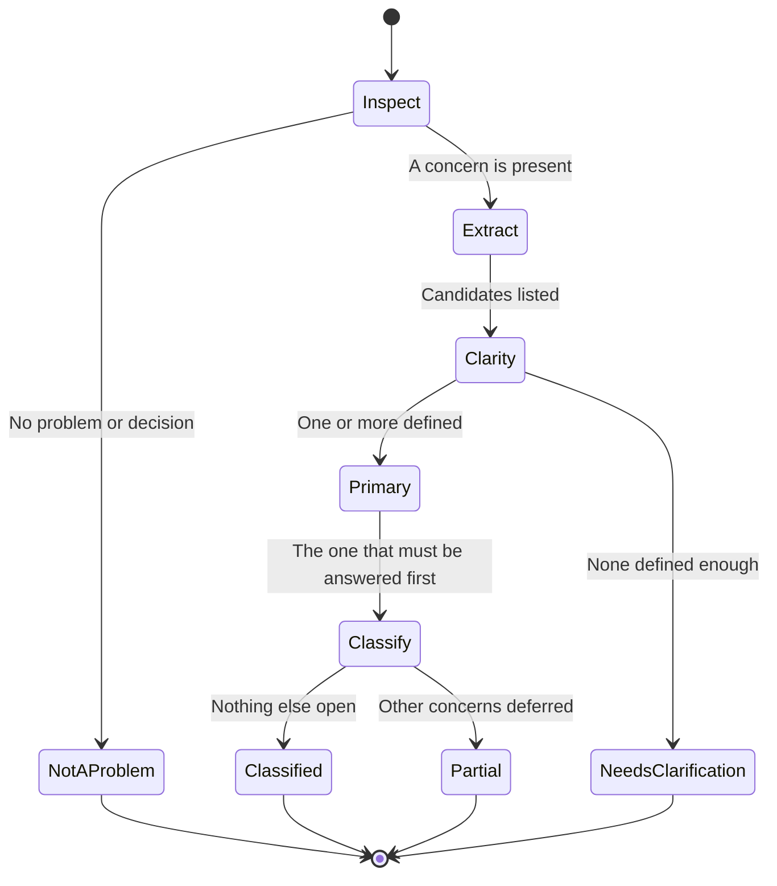

# How to use whats-going-on (slice 1)

Tagline: Understand the situation before deciding what to solve.

`/whats-going-on` examines an ask, message, or described situation. Slice 1 finds what needs resolving in that input, picks at most one primary problem, decides whether it is defined enough to classify, and maps it onto a 2×2. It stops before diagnosis, brainstorming, or solutions.

Works with Cursor Agent Skills, Claude Code skills, and Codex skills. Same `SKILL.md` body. Install path differs by tool.

Slice 1 capability name: problem mapping. Method: analytical or conceptual, crossed with convergent or divergent.

## What slice 1 does

Paste a bug, email, Slack thread, GitHub comment, incident report, link plus context, or plain text. The agent does not assume the paste contains a problem. It inspects first.

### The 2×2

| | Analytical | Conceptual |
|---|---|---|
| **Convergent** | Work with data toward one factual answer | Explore ideas, then settle on one or two fixes |
| **Divergent** | Work with data while many explanations stay open | Explore many approaches. No single right answer yet |

### Four things to keep separate

1. Situation. What is happening or what someone said.
2. Problem. What needs to be understood, decided, or resolved.
3. Proposed approach. What someone thinks should be done (a cost model, a workshop, a couple of quick fixes).
4. Classification. What kind of reasoning the actual problem needs right now.

Do not classify a proposed method as the problem. Identify the question the work is meant to answer.

### Outcomes

| Outcome | When | Behavior |
|---|---|---|
| `not_a_problem` | No decision or problem to resolve (for example a pure FYI) | Say so and stop |
| `needs_clarification` | Concern or symptom is present, but the problem is not defined enough | Abstain. Ask for what is missing |
| `classified` | One primary problem is defined and nothing else is open | State the problem and its quadrant |
| `partial` | One primary problem is defined, other concerns stay open | Classify the primary. List the rest in `unresolved` |

Hard fail: inventing details to force a quadrant, or starting to solve while classifying.

## Slice 1 flow



Sharpen one primary problem, the one that must be answered first. Leave every other concern in `unresolved` until that primary is answered.

## Invariants

1. Identification before classification. Never force an undefined concern into the matrix.
2. One primary problem. Other concerns wait in `unresolved` until the primary is answered.
3. Abstention is valid. Missing data to *solve* does not block classification. Missing data to *identify* does.
4. Classification is a snapshot. The quadrant describes the current reasoning objective, not a permanent property of the situation.
5. No solving. No root-cause hunt, issue trees, brainstorms, plans, or recommendations in this slice.

## The restatement

The reply is exactly two sentences, then one fenced `yaml` block, then nothing.

The first sentence names who asks for what, in the asker's terms. When nobody asks for anything, write exactly `No ask is stated.`

The second sentence says what is going on. Use only facts from the input. When the input includes a link you could not open, say so in this sentence.

The restatement reports. It does not name a problem, a cause, a quadrant, or a fix. Those belong in the YAML. When the input defines no problem, a short restatement is the right one.

When the two sentences disagree with the primary or with `unresolved`, discard them and restate again. Do not edit the sentences in place. Do not add a problem so that they match.

## Output contract

```yaml
status: classified | partial | needs_clarification | not_a_problem

problems:
  - statement: "Clear statement of what needs resolving"
    classification:
      nature: analytical | conceptual
      direction: convergent | divergent
    confidence: high | medium | low
    why: "Evidence for both dimensions"
    next_method: "Kind of reasoning to use next, not the answer"

unresolved:
  - observation: "What was said"
    reason: "Why this is not yet a defined problem"
    clarification: "What to ask next"

stop: true
```

`problems` holds at most one item, the primary. An empty `problems` list is valid when status is `needs_clarification` or `not_a_problem`. Always emit `unresolved`. Write `[]` when it is empty.

## Install

This folder is the canonical skill body. Keep `SKILL.md` and this README together. Symlink or copy this folder into a host skills path. See [docs/install.md](../../docs/install.md) for the full matrix.

| Tool | Preferred location |
|---|---|
| Cursor | `.cursor/skills/whats-going-on/` in the project, or `~/.cursor/skills/whats-going-on/` for all projects |
| Claude Code | `.claude/skills/whats-going-on/` in the project, or `~/.claude/skills/whats-going-on/` |
| Codex | `~/.agents/skills/whats-going-on/` or `.agents/skills/whats-going-on/` |

Codex legacy path. `.codex/skills/whats-going-on/` (and `~/.codex/skills/`) on older builds only.

Executable evals live in the sibling folder `evals/whats-going-on/`. Do not copy that folder into a tool skills path.

## Invoke

Attach or mention the skill, then pass the situation as the user message. Raw text is enough.

```text
/whats-going-on

<paste the situation>
```

If you pass a link the agent cannot open, classify from the pasted context and say the link was not read.

## Worked cases

Each case shows the input, what the skill should notice, and the expected slice 1 result. Scenarios are original. They are not copied from a training course.

### Case A. Vague concern (abstain)

**Input**

```text
Slack from a product owner:
"Mobile is in a rough place right now and every eng has a different theory.
Can you help me figure out where we should even look first?"
```

**What to notice**

"Rough place" is a symptom, not a problem. Competing theories are noise until you know what changed, by how much, and since when. Do not invent crash rates, retention drops, or store-ranking theories.

**Expected result**

```yaml
status: needs_clarification
problems: []
unresolved:
  - observation: "Mobile is in a rough place; eng has competing theories"
    reason: "No measurable change, magnitude, or timeframe. Competing theories are not yet a defined question."
    clarification: "What changed, by how much, and since when? What decision are you trying to make?"
stop: true
```

### Case B. Analytical, convergent

**Input**

```text
From your engineering manager:
"Need p99 latency estimates for the checkout API before Friday's capacity review.
We'll use them to set the Q1 hardware budget."
```

**What to notice**

One estimate for one review. Data does the work. One answer.

**Expected result**

```yaml
status: classified
problems:
  - statement: "What p99 latency estimates for the checkout API should inform the Q1 hardware budget?"
    classification:
      nature: analytical
      direction: convergent
    confidence: high
    why: "Latency estimation needs quantitative data. The objective is one figure for a defined capacity decision."
    next_method: "Estimate from production telemetry and load assumptions. Do not open an architecture redesign workshop."
unresolved: []
stop: true
```

Stop before producing the estimate.

### Case C. Conceptual, convergent

**Input**

```text
From a design lead:
"Tickets keep bouncing between Design and Eng with missing acceptance criteria.
Let's lock one or two handoff changes this sprint so the bounce stops."
```

**What to notice**

The topic is a way of working, not a number. "One or two handoff changes" already narrows. The proposed approach is not proof that handoff process is the only cause. Classify the asked-for decision, not a diagnosis you invent.

**Expected result**

```yaml
status: classified
problems:
  - statement: "Which one or two handoff changes should Design and Eng adopt so tickets stop bouncing for missing acceptance criteria?"
    classification:
      nature: conceptual
      direction: convergent
    confidence: high
    why: "The ask is about a collaboration process. The lead wants a small set of concrete changes this sprint, not open exploration."
    next_method: "Generate and narrow handoff changes toward one or two fixes. Do not propose the fixes in this slice."
unresolved: []
stop: true
```

### Case D. Conceptual, divergent

**Input**

```text
From a teammate after a messy on-call week:
"We hired three new people onto the platform squad.
How do we build a healthy on-call culture over the next year?"
```

**What to notice**

Culture and norms are conceptual. "How do we" over a year leaves many approaches open. A desired change counts as a valid problem even when nothing is on fire right now.

**Expected result**

```yaml
status: classified
problems:
  - statement: "What approaches could build a healthy on-call culture on the platform squad over the next year?"
    classification:
      nature: conceptual
      direction: divergent
    confidence: high
    why: "Culture and norms are conceptual. The ask invites many possible moves. No short list of options is fixed yet."
    next_method: "Broad exploration of approaches before any narrowing. Do not brainstorm the list in this slice."
unresolved: []
stop: true
```

### Case E. UX scope before a deadline (conceptual, convergent)

**Input**

```text
Comment on a design review:
"Enterprise trial users say the admin console is overwhelming.
Can we settle on one or two UI changes to cut the clutter before the demo on the 20th?"
```

**What to notice**

Simplifying an interface is design judgment, not a dataset. "Settle on one or two" by a fixed date is convergent.

**Expected result**

```yaml
status: classified
problems:
  - statement: "Which one or two admin-console UI changes should we make before the enterprise demo to reduce overwhelm?"
    classification:
      nature: conceptual
      direction: convergent
    confidence: high
    why: "Clutter reduction is a design and priority call. The ask already requires settling on a small set of changes by a deadline."
    next_method: "Compare candidate UI changes and narrow to one or two. Do not pick them in this slice."
unresolved: []
stop: true
```

### Case F. Compound ask (one primary)

**Input**

```text
From the director of engineering after a staging outage:
"I want to know exactly why staging went down last night, and I want three realistic
ways to stop this class of failure, ranked by how likely they are to work."
```

**What to notice**

Two questions in one sentence. "Why staging went down" is diagnosis. "How to stop this class of failure" is option generation, and it depends on the answer to the first. The why is the primary problem. The prevention ask waits in `unresolved` until the why is answered.

**Expected result**

```yaml
status: partial
problems:
  - statement: "Why did staging go down last night?"
    classification:
      nature: analytical
      direction: convergent
    confidence: high
    why: "The ask wants an exact reason. Evidence should converge on what happened."
    next_method: "Evidence-based incident diagnosis. Finish this before prevention options."
unresolved:
  - observation: "The director also wants three realistic ways to stop this class of failure, ranked by likelihood"
    reason: "Deferred until the primary problem is answered. Prevention options depend on why staging went down."
    clarification: "Ask about prevention again once the cause of the outage is settled."
stop: true
```

### Case G. Wrong method for the real disagreement

**Input**

```text
A teammate spent a week building a spreadsheet of lines of code and deploy counts per service.
Two directors disagree on which services to sunset first.
The fight is about product strategy and customer impact, not code volume.
```

**What to notice**

The proposed deliverable (LOC spreadsheet) is not the problem. The unresolved question is how to prioritize sunsets. Metrics cannot settle a strategy fight by themselves.

**Expected result**

```yaml
status: classified
problems:
  - statement: "How should the directors decide which services to sunset first?"
    classification:
      nature: conceptual
      direction: convergent
    confidence: high
    why: "The conflict is strategy and customer impact. They need decision criteria, not another size spreadsheet."
    next_method: "Clarify decision criteria and trade-offs among services. Do not expand the LOC spreadsheet in this slice."
unresolved: []
stop: true
```

Call out the mismatch. The ask-to-do was analytical. The need-to-resolve is conceptual.

### Case H. Incident notes that mix method and cause

**Input**

```text
Incident call notes (2026-11-10):
Checkout API timeouts spiked across three regions this morning.
Ops wants a two-day architecture workshop on "resilient request paths" this week.
Someone mentioned the connection pool max was lowered in yesterday's config change.
```

**What to notice**

Timeouts are a symptom. The workshop is a proposed method. A recent pool-size change suggests an analytical path that may converge on a factual cause. Do not classify "run an architecture workshop" as the problem.

**Expected result (typical)**

```yaml
status: partial
problems:
  - statement: "Are checkout API timeouts explained by the lowered connection-pool max, or by something else measurable?"
    classification:
      nature: analytical
      direction: divergent
    confidence: medium
    why: "The notes point at a data-checkable cause space. Several explanations remain open."
    next_method: "Gather facts on pool config, error rates, and timing before any architecture workshop."
unresolved:
  - observation: "Ops wants a two-day architecture workshop on resilient request paths"
    reason: "That is a proposed approach, not a defined problem. Redesign may be wrong if the pool config is the cause."
    clarification: "What decision must this week's work settle? Confirm root cause first, or commit to redesign regardless?"
stop: true
```

### Case I. Not a problem

**Input**

```text
FYI, the Friday deploy window moved to Saturday 10:00 UTC.
```

**Expected result**

```yaml
status: not_a_problem
problems: []
unresolved: []
stop: true
```

### Case J. Same situation, successive asks (snapshot, not lifecycle)

Slice 1 does not advance a problem through stages on its own. Each invocation classifies the current question.

| Invocation | Ask | Result |
|---|---|---|
| 1 | "Mobile is in a rough place." | `needs_clarification` |
| 2 | "Crash-free sessions dropped 8% in four weeks. Why?" | Analytical, convergent |
| 3 | "What product or eng initiatives could recover crash-free sessions?" | Conceptual, divergent |
| 4 | "Which of these three recovery initiatives should we fund?" | Conceptual, convergent |

More information alone does not flip divergent to convergent. Changing the question does.

## What this slice is not

- Not root-cause analysis, issue trees, leverage scoring, or recommendations.
- Not a full problem-solving workflow. Later slices can consume these labels.
- Not a permanent tag on a situation. Re-run when the ask changes.

## Quick check

After install, run Case A and Case F by hand, or from the repo:

```bash
cd evals/whats-going-on && source .venv/bin/activate
python -m whats_going_on_eval check
python -m whats_going_on_eval run --agent cursor --only case-a,case-f --repeat 1
```

- Case A must abstain and ask for change, magnitude, and timeframe (or equivalent clarity).
- Case F must return the why as the one problem and defer the prevention ask to `unresolved`.
- If the agent proposes mobile fixes or a prevention plan, slice 1 failed.
- `check` needs no agent. `run` needs a wired host CLI (stubbed until confirmed).
