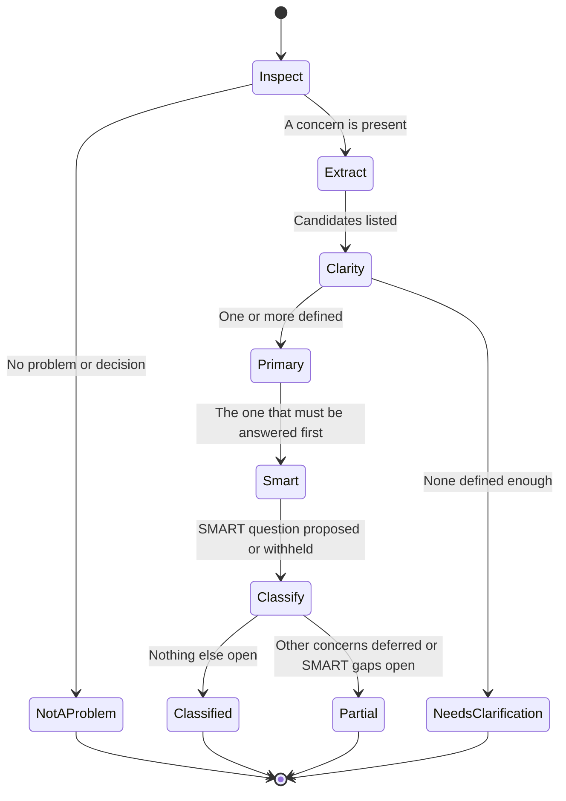

# How to use whats-going-on (stage 1)

Tagline: Understand the situation before deciding what to solve.

`/whats-going-on` examines an ask, message, or described situation. Stage 1 (`define-the-problem`) finds what needs resolving in that input, picks at most one primary problem, names it as the `main_question` to answer first, proposes one SMART version of it as `smart_question`, decides whether it is defined enough to classify, and maps it onto a 2×2. Each SMART letter the input leaves open becomes an `Ask yourself:` question. It cites principles under `applied` when they decided a value. It stops before diagnosis, brainstorming, or solutions.

Works with Cursor Agent Skills, Claude Code skills, and Codex skills. Same `SKILL.md` body. Install path differs by tool.

Stage 1 capability name: problem mapping. Method: analytical or conceptual, crossed with convergent or divergent. Stages 2–7 are named on the coordinator chain and Halt until their playbooks exist.

## What stage 1 does

Paste a bug, email, Slack thread, GitHub comment, incident report, link plus context, or plain text. The agent does not assume the paste contains a problem. It inspects first.

### The 2×2

| | Analytical | Conceptual |
|---|---|---|
| **Convergent** | Work with data toward one factual answer | Explore ideas, then settle on one or two fixes |
| **Divergent** | Work with data while many explanations stay open | Explore many approaches. No single right answer yet |

### Four things to keep separate

1. Situation. What is happening or what someone said.
2. Problem. What needs to be understood, decided, or resolved.
3. Proposed approach. What someone thinks should be done (a cost model, a workshop, a couple of quick fixes).
4. Classification. What kind of reasoning the actual problem needs right now.

Do not classify a proposed method as the problem. Identify the question the work is meant to answer.

### Outcomes

| Outcome | When | Behavior |
|---|---|---|
| `not_a_problem` | No decision or problem to resolve (for example a pure FYI or a fully specified rename) | Say so and stop |
| `needs_clarification` | Concern or symptom is present, but the problem is not defined enough | Abstain. Ask for what is missing |
| `classified` | One primary problem is defined, nothing else is open, and the input meets every SMART letter | State the problem, its SMART question, and its quadrant |
| `partial` | One primary problem is defined, and other concerns or SMART gaps stay open | Classify the primary. List the rest in `unresolved` |

Hard fail: inventing details to force a quadrant, or starting to solve while classifying.

## Stage 1 flow

Before Extract, the playbook runs `ask`, `restate` (exactly two sentences), and `separate`. The diagram starts after that setup.



## Principles

Each judgment rule has one owner, a `principle-*` leaf the coordinator names in its `## Principles` index. Stage skills keep the mechanics and point at the owner. When a principle decides a value in the reply, the YAML cites it under `applied`.

| Principle | Rule | Governs |
|---|---|---|
| `principle-dont-invent-problems` | Identify before you classify. Missing data to *solve* does not block a problem. Missing data to *identify* does, so abstain. Never invent facts, metrics, or causes. | `problem`, `unresolved`, `classification`, `smart_question` |
| `principle-read-the-room` | One primary problem, the one the others wait on. The rest wait in `unresolved`. Research that informs a decision is that decision's `next_method`, not the primary. The quadrant is a snapshot of the current reasoning objective. | `problem`, `unresolved`, `classification` |
| `principle-dont-solve-yet` | No root-cause hunt, issue trees, brainstorms, plans, or recommendations. `next_method` names a kind of reasoning, not its result. | `problem`, `unresolved`, `smart_question` |
| `principle-make-it-smart` | A SMART letter is met only when the input states it. Each open letter becomes an `Ask yourself:` row. No `smart_question` while specific or actionable is open. Answers are new facts for the next run. | `smart_question`, `unresolved` |

## The restatement

The reply is exactly two sentences, then one fenced `yaml` block, then nothing.

The first sentence names who asks for what, in the asker's terms. When nobody asks for anything, write exactly `No ask is stated.`

The second sentence says what is going on. Use only facts from the input. When the input includes a link you could not open, say so in this sentence.

The restatement reports. It does not name a problem, a cause, a quadrant, or a fix. Those belong in the YAML. When the input defines no problem, a short restatement is the right one.

When the two sentences disagree with the primary or with `unresolved`, discard them and restate again. Do not edit the sentences in place.

## The SMART question

After the primary is picked and before it is classified, the `smart` step checks it against five cards. A letter is met only when the input states it.

| Letter | Required | Prompt |
|---|---|---|
| `specific` | yes | Would someone new to this know exactly which problem it is? |
| `measurable` | no | How will we know it is solved? |
| `actionable` | yes | Does it point to something we can do? |
| `relevant` | no | Does it matter to the people who will decide? |
| `time_bound` | no | By when does it need to be solved? |

- `smart_question` is the primary rewritten to carry the facts behind each met letter. It is `null` while `specific` or `actionable` is open (Case K).
- `smart_gaps` lists the open letters in card order.
- Each open letter adds one `unresolved` row, after every other row, whose `clarification` is `Ask yourself: ` plus the card prompt word for word. Those rows make the status `partial`.
- A why question counts as actionable when its cause sits in something the team can inspect (Case F).
- `main_question` stays the primary's statement. The 2×2 classifies the primary, not the SMART question.
- With no primary (Cases A and I), `smart_question` is `null` and `smart_gaps` is `[]`.

To answer the Ask-yourself questions, reply with the answers in the same chat. The next run treats them as new facts, derives the SMART question again from the earlier ask plus the answers, and carries nothing over (Case L). In a fresh chat, paste the earlier ask along with the answers.

## Output contract

```yaml
status: classified | partial | needs_clarification | not_a_problem

main_question: "The primary's statement, word for word" | null

problems:
  - statement: "Clear statement of what needs resolving"
    classification:
      nature: analytical | conceptual
      direction: convergent | divergent
    confidence: high | medium | low
    why: "Evidence for both dimensions"
    next_method: "Kind of reasoning to use next, not the answer"

smart_question: "The primary, carrying each met SMART letter's facts" | null

smart_gaps: [specific | measurable | actionable | relevant | time_bound]

unresolved:
  - observation: "What was said"
    reason: "Why this is not yet a defined problem"
    clarification: "What to ask next"

applied:
  - name: principle-<name>
    at: status | problems[0] | problems[0].classification | problems[0].confidence | smart_question | unresolved[<i>]
    changed: "The choice the principle changed, in one line"

stop: true
```

`problems` holds at most one item, the primary. An empty `problems` list is valid when status is `needs_clarification` or `not_a_problem`. Always emit `main_question`. Copy the primary's `statement` into it exactly. Write `null` when `problems` is empty. Always emit `smart_question` and `smart_gaps`. Write `null` and `[]` when there is no primary. Always emit `unresolved`, with any gap rows last. Write `[]` when it is empty. Always emit `applied`. Write `[]` when no principle decided a value.

## Install

This folder is the canonical skill body. Keep `SKILL.md` and this README together. Symlink or copy this folder into a host skills path. See [docs/install.md](../../docs/install.md) for the full matrix.

| Tool | Preferred location |
|---|---|
| Cursor | `.cursor/skills/whats-going-on/` in the project, or `~/.cursor/skills/whats-going-on/` for all projects |
| Claude Code | `.claude/skills/whats-going-on/` in the project, or `~/.claude/skills/whats-going-on/` |
| Codex | `~/.agents/skills/whats-going-on/` or `.agents/skills/whats-going-on/` |

Codex legacy path. `.codex/skills/whats-going-on/` (and `~/.codex/skills/`) on older builds only.

Executable evals live in the sibling folder `evals/whats-going-on/`. Do not copy that folder into a tool skills path.

## Invoke

Attach or mention the skill, then pass the situation as the user message. Raw text is enough.

```text
/whats-going-on

<paste the situation>
```

If you pass a link the agent cannot open, classify from the pasted context and say the link was not read.

## Worked cases

Each case shows the input, what the skill should notice, and the expected stage 1 result. Scenarios are original. They are not copied from a training course.

### Case A. Vague concern (abstain)

**Input**

```text
Slack from a product owner:
"Mobile is in a rough place right now and every eng has a different theory.
Can you help me figure out where we should even look first?"
```

**What to notice**

"Rough place" is a symptom, not a problem. Competing theories are noise until you know what changed, by how much, and since when. Do not invent crash rates, retention drops, or store-ranking theories.

**Expected result**

```yaml
status: needs_clarification
main_question: null
problems: []
smart_question: null
smart_gaps: []
unresolved:
  - observation: "Mobile is in a rough place; eng has competing theories"
    reason: "No measurable change, magnitude, or timeframe. Competing theories are not yet a defined question."
    clarification: "What changed, by how much, and since when? What decision are you trying to make?"
applied:
  - name: principle-dont-invent-problems
    at: unresolved[0]
    changed: "Kept the concern unresolved instead of naming a metric or cause the input never gives."
stop: true
```

### Case B. Analytical, convergent

**Input**

```text
From your engineering manager:
"Need p99 latency estimates for the checkout API before Friday's capacity review.
We'll use them to set the Q1 hardware budget."
```

**What to notice**

One estimate for one review. Data does the work. One answer.

**Expected result**

```yaml
status: classified
main_question: "What p99 latency estimates for the checkout API should inform the Q1 hardware budget?"
problems:
  - statement: "What p99 latency estimates for the checkout API should inform the Q1 hardware budget?"
    classification:
      nature: analytical
      direction: convergent
    confidence: high
    why: "Latency estimation needs quantitative data. The objective is one figure for a defined capacity decision."
    next_method: "Estimate from production telemetry and load assumptions. Do not open an architecture redesign workshop."
smart_question: "What p99 latency estimates for the checkout API should inform the Q1 hardware budget at Friday's capacity review?"
smart_gaps: []
unresolved: []
applied: []
stop: true
```

Stop before producing the estimate.

### Case C. Conceptual, convergent

**Input**

```text
From a design lead:
"Tickets keep bouncing between Design and Eng with missing acceptance criteria.
Let's lock one or two handoff changes this sprint so the bounce stops."
```

**What to notice**

The topic is a way of working, not a number. "One or two handoff changes" already narrows. The proposed approach is not proof that handoff process is the only cause. Classify the asked-for decision, not a diagnosis you invent.

**Expected result**

```yaml
status: classified
main_question: "Which one or two handoff changes should Design and Eng adopt so tickets stop bouncing for missing acceptance criteria?"
problems:
  - statement: "Which one or two handoff changes should Design and Eng adopt so tickets stop bouncing for missing acceptance criteria?"
    classification:
      nature: conceptual
      direction: convergent
    confidence: high
    why: "The ask is about a collaboration process. The lead wants a small set of concrete changes this sprint, not open exploration."
    next_method: "Generate and narrow handoff changes toward one or two fixes. Do not propose the fixes in this slice."
smart_question: "Which one or two handoff changes should Design and Eng lock this sprint so tickets stop bouncing for missing acceptance criteria?"
smart_gaps: []
unresolved: []
applied: []
stop: true
```

### Case D. Conceptual, divergent

**Input**

```text
From a teammate after a messy on-call week:
"We hired three new people onto the platform squad.
How do we build a healthy on-call culture over the next year?"
```

**What to notice**

Culture and norms are conceptual. "How do we" over a year leaves many approaches open. A desired change counts as a valid problem even when nothing is on fire right now. "Healthy" is not a sign of done, and nobody is named as the decider, so measurable and relevant become Ask-yourself rows. The primary is classified anyway. The status is `partial` only because of those rows.

**Expected result**

```yaml
status: partial
main_question: "What approaches could build a healthy on-call culture on the platform squad over the next year?"
problems:
  - statement: "What approaches could build a healthy on-call culture on the platform squad over the next year?"
    classification:
      nature: conceptual
      direction: divergent
    confidence: high
    why: "Culture and norms are conceptual. The ask invites many possible moves. No short list of options is fixed yet."
    next_method: "Broad exploration of approaches before any narrowing. Do not brainstorm the list in this slice."
smart_question: "What approaches could build a healthy on-call culture on the platform squad over the next year?"
smart_gaps: [measurable, relevant]
unresolved:
  - observation: "The ask says healthy but not what healthy looks like"
    reason: "SMART measurable is missing. The input gives no sign of done."
    clarification: "Ask yourself: How will we know it is solved?"
  - observation: "The ask does not say who decides on on-call changes"
    reason: "SMART relevant is missing. The input names no decider or stake."
    clarification: "Ask yourself: Does it matter to the people who will decide?"
applied:
  - name: principle-make-it-smart
    at: unresolved[0]
    changed: "Asked for a sign of done instead of treating healthy as measurable."
  - name: principle-dont-invent-problems
    at: smart_question
    changed: "Kept the SMART question to the input's own scope instead of adding a metric."
stop: true
```

### Case E. UX scope before a deadline (conceptual, convergent)

**Input**

```text
Comment on a design review:
"Enterprise trial users say the admin console is overwhelming.
Can we settle on one or two UI changes to cut the clutter before the demo on the 20th?"
```

**What to notice**

Simplifying an interface is design judgment, not a dataset. "Settle on one or two" by a fixed date is convergent.

**Expected result**

```yaml
status: classified
main_question: "Which one or two admin-console UI changes should we make before the enterprise demo to reduce overwhelm?"
problems:
  - statement: "Which one or two admin-console UI changes should we make before the enterprise demo to reduce overwhelm?"
    classification:
      nature: conceptual
      direction: convergent
    confidence: high
    why: "Clutter reduction is a design and priority call. The ask already requires settling on a small set of changes by a deadline."
    next_method: "Compare candidate UI changes and narrow to one or two. Do not pick them in this slice."
smart_question: "Which one or two admin-console UI changes should we settle on before the enterprise demo on the 20th to cut the clutter trial users report?"
smart_gaps: []
unresolved: []
applied: []
stop: true
```

### Case F. Compound ask (one primary)

**Input**

```text
From the director of engineering after a staging outage:
"I want to know exactly why staging went down last night, and I want three realistic
ways to stop this class of failure, ranked by how likely they are to work."
```

**What to notice**

Two questions in one sentence. "Why staging went down" is diagnosis. "How to stop this class of failure" is option generation, and it depends on the answer to the first. The why is the primary problem. The prevention ask waits in `unresolved` until the why is answered. Finding the cause of an outage in our own staging is something we can do, so the why meets actionable. "Last night" is when staging failed, not when the answer is due, so time_bound is open.

**Expected result**

```yaml
status: partial
main_question: "Why did staging go down last night?"
problems:
  - statement: "Why did staging go down last night?"
    classification:
      nature: analytical
      direction: convergent
    confidence: high
    why: "The ask wants an exact reason. Evidence should converge on what happened."
    next_method: "Evidence-based incident diagnosis. Finish this before prevention options."
smart_question: "Why exactly did staging go down last night?"
smart_gaps: [time_bound]
unresolved:
  - observation: "The director also wants three realistic ways to stop this class of failure, ranked by likelihood"
    reason: "Deferred until the primary problem is answered. Prevention options depend on why staging went down."
    clarification: "Ask about prevention again once the cause of the outage is settled."
  - observation: "The director does not say by when the cause must be known"
    reason: "SMART time_bound is missing. Last night is when staging went down, not when the answer is due."
    clarification: "Ask yourself: By when does it need to be solved?"
applied:
  - name: principle-read-the-room
    at: problems[0]
    changed: "Picked the why as primary because the prevention options depend on its answer."
  - name: principle-read-the-room
    at: unresolved[0]
    changed: "Deferred the prevention ask instead of classifying it now."
stop: true
```

### Case G. Wrong method for the real disagreement

**Input**

```text
A teammate spent a week building a spreadsheet of lines of code and deploy counts per service.
Two directors disagree on which services to sunset first.
The fight is about product strategy and customer impact, not code volume.
```

**What to notice**

The proposed deliverable (LOC spreadsheet) is not the problem. The unresolved question is how to prioritize sunsets. Metrics cannot settle a strategy fight by themselves.

**Expected result**

```yaml
status: partial
main_question: "How should the directors decide which services to sunset first?"
problems:
  - statement: "How should the directors decide which services to sunset first?"
    classification:
      nature: conceptual
      direction: convergent
    confidence: high
    why: "The conflict is strategy and customer impact. They need decision criteria, not another size spreadsheet."
    next_method: "Clarify decision criteria and trade-offs among services. Do not expand the LOC spreadsheet in this slice."
smart_question: "How should the two directors decide which services to sunset first, weighing product strategy and customer impact?"
smart_gaps: [time_bound]
unresolved:
  - observation: "The input gives no date for the sunset decision"
    reason: "SMART time_bound is missing. The input gives no date by which the answer is needed."
    clarification: "Ask yourself: By when does it need to be solved?"
applied: []
stop: true
```

Call out the mismatch. The ask-to-do was analytical. The need-to-resolve is conceptual.

### Case H. Incident notes that mix method and cause

**Input**

```text
Incident call notes (2026-11-10):
Checkout API timeouts spiked across three regions this morning.
Ops wants a two-day architecture workshop on "resilient request paths" this week.
Someone mentioned the connection pool max was lowered in yesterday's config change.
```

**What to notice**

Timeouts are a symptom. The workshop is a proposed method. A recent pool-size change suggests an analytical path that may converge on a factual cause. Do not classify "run an architecture workshop" as the problem.

**Expected result (typical)**

```yaml
status: partial
main_question: "Are checkout API timeouts explained by the lowered connection-pool max, or by something else measurable?"
problems:
  - statement: "Are checkout API timeouts explained by the lowered connection-pool max, or by something else measurable?"
    classification:
      nature: analytical
      direction: divergent
    confidence: medium
    why: "The notes point at a data-checkable cause space. Several explanations remain open."
    next_method: "Gather facts on pool config, error rates, and timing before any architecture workshop."
smart_question: "Are this morning's checkout API timeouts across three regions explained by yesterday's lowered connection-pool max, or by something else measurable, before Ops commits to this week's workshop?"
smart_gaps: []
unresolved:
  - observation: "Ops wants a two-day architecture workshop on resilient request paths"
    reason: "That is a proposed approach, not a defined problem. Redesign may be wrong if the pool config is the cause."
    clarification: "What decision must this week's work settle? Confirm root cause first, or commit to redesign regardless?"
applied:
  - name: principle-read-the-room
    at: problems[0]
    changed: "Put the timeout question first because whether to redesign depends on its answer."
  - name: principle-dont-invent-problems
    at: unresolved[0]
    changed: "Kept the workshop request unresolved instead of treating a proposed approach as a problem."
stop: true
```

### Case I. Not a problem

**Input**

```text
FYI, the Friday deploy window moved to Saturday 10:00 UTC.
```

**Expected result**

```yaml
status: not_a_problem
main_question: null
problems: []
smart_question: null
smart_gaps: []
unresolved: []
applied: []
stop: true
```

### Case J. Same situation, successive asks (snapshot, not lifecycle)

Stage 1 does not advance a problem through stages on its own. Each invocation classifies the current question.

| Invocation | Ask | Result |
|---|---|---|
| 1 | "Mobile is in a rough place." | `needs_clarification` |
| 2 | "Crash-free sessions dropped 8% in four weeks. Why?" | Analytical, convergent |
| 3 | "What product or eng initiatives could recover crash-free sessions?" | Conceptual, divergent |
| 4 | "Which of these three recovery initiatives should we fund?" | Conceptual, convergent |

More information alone does not flip divergent to convergent. Changing the question does. Invocations 2 to 4 are `partial`, because each one-line ask leaves SMART letters open, such as who decides or by when.

### Case K. SMART question withheld

**Input**

```text
Slack from a sales lead:
"Our biggest competitor raised list prices 20% this week.
What are they up to?"
```

**What to notice**

The why is defined and gets a quadrant. It is about another company's motive, and the input names nothing we would do with the answer, so actionable is open. Without actionable, a SMART question would be a guess, so `smart_question` stays `null` and the gap rows ask. Do not invent a pricing response to make it actionable.

**Expected result**

```yaml
status: partial
main_question: "Why did our biggest competitor raise list prices 20% this week?"
problems:
  - statement: "Why did our biggest competitor raise list prices 20% this week?"
    classification:
      nature: analytical
      direction: divergent
    confidence: medium
    why: "The ask is about another company's motive. Several explanations stay open, and only outside evidence bears on them."
    next_method: "Gather public evidence on the price change and keep explanations open. Do not plan a response in this slice."
smart_question: null
smart_gaps: [measurable, actionable, relevant, time_bound]
unresolved:
  - observation: "The ask does not say what knowing their aim would look like"
    reason: "SMART measurable is missing. The input gives no sign of done."
    clarification: "Ask yourself: How will we know it is solved?"
  - observation: "The ask names nothing we would do with the answer"
    reason: "SMART actionable is missing. The competitor's motive is outside our reach, and no move of ours is named."
    clarification: "Ask yourself: Does it point to something we can do?"
  - observation: "The ask names no decision the answer feeds"
    reason: "SMART relevant is missing. The input names no decider or stake."
    clarification: "Ask yourself: Does it matter to the people who will decide?"
  - observation: "The ask gives no date by which the answer is needed"
    reason: "SMART time_bound is missing. This week is when prices rose, not when the answer is due."
    clarification: "Ask yourself: By when does it need to be solved?"
applied:
  - name: principle-make-it-smart
    at: smart_question
    changed: "Withheld the SMART question because the ask points to nothing we can do yet."
stop: true
```

### Case L. Answering the Ask-yourself questions

**Input**

```text
Earlier ask, from a teammate after a messy on-call week:
"We hired three new people onto the platform squad.
How do we build a healthy on-call culture over the next year?"

Answers to the Ask-yourself questions:
Healthy means nobody carries more than one week of pages a month. The platform lead decides.
```

**What to notice**

This answers Case D's two gap rows. The answers are new facts, so the run starts over from the ask plus the answers. `main_question` does not move. `smart_question` now carries the sign of done and the decider, and with no letter open the status is `classified`.

**Expected result**

```yaml
status: classified
main_question: "What approaches could build a healthy on-call culture on the platform squad over the next year?"
problems:
  - statement: "What approaches could build a healthy on-call culture on the platform squad over the next year?"
    classification:
      nature: conceptual
      direction: divergent
    confidence: high
    why: "Culture and norms are conceptual. The ask invites many possible moves. No short list of options is fixed yet."
    next_method: "Broad exploration of approaches before any narrowing. Do not brainstorm the list in this slice."
smart_question: "What approaches could the platform lead adopt so nobody on the platform squad carries more than one week of pages a month within the next year?"
smart_gaps: []
unresolved: []
applied: []
stop: true
```

## What stage 1 is not

- Not root-cause analysis, issue trees, leverage scoring, or recommendations.
- Not a full problem-solving workflow. Later stages Halt until their playbooks ship.
- Not a permanent tag on a situation. Re-run when the ask changes.

## Quick check

After install, run Case A and Case F by hand, or from the repo:

```bash
cd evals/whats-going-on && source .venv/bin/activate
python -m whats_going_on_eval check
python -m whats_going_on_eval run --agent cursor --only case-a,case-f --repeat 1
```

- Case A must abstain and ask for change, magnitude, and timeframe (or equivalent clarity).
- Case F must return the why as the one problem and defer the prevention ask to `unresolved`.
- If the agent proposes mobile fixes or a prevention plan, stage 1 failed.
- `check` needs no agent. `run --agent cursor` invokes the Cursor `agent` CLI. That path needs `agent` on `PATH` and `agent login` or `CURSOR_API_KEY`. Claude and Codex are not wired yet.
- Maintainer alternative. `.cursor/skills/verify-whats-going-on/bin/wgo-verify` launches an isolated HOME and drives the same gates and fixtures.
